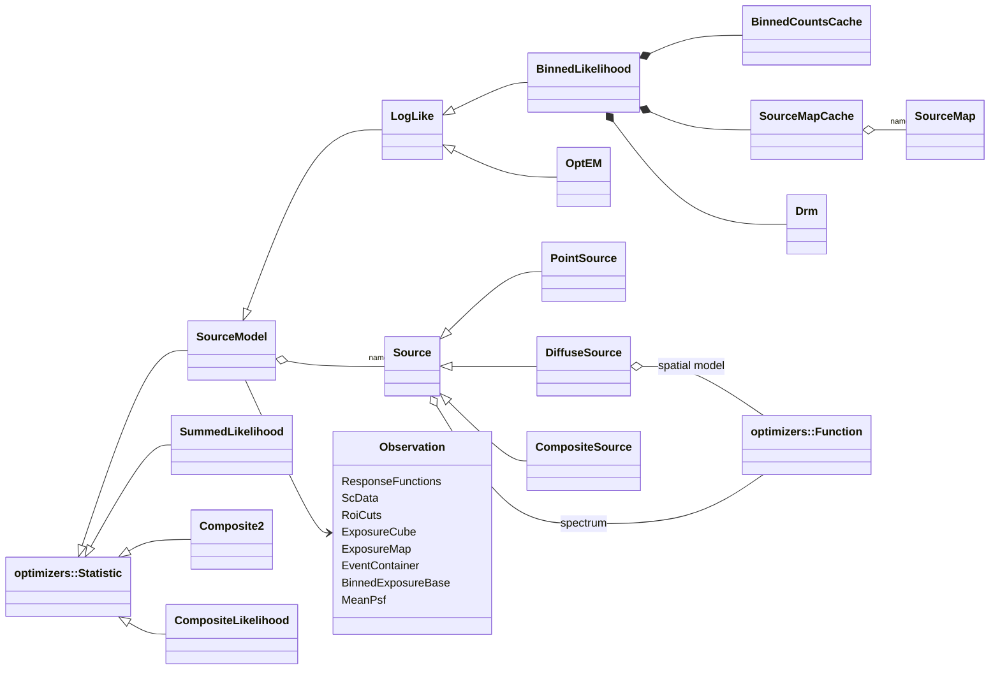

# Likelihood Architecture

**Likelihood** is the analysis core of the Fermitools. It contains:

1. A **C++ library** (`libLikelihood`, about 33k lines of `.cxx` and 17k
   lines of headers) that models the gamma-ray sky as a set of sources,
   folds the model through the instrument response, and evaluates the
   Poisson log-likelihood of LAT data. The binned and unbinned likelihoods
   are `optimizers::Statistic` objects, so any `optimizers` minimizer can
   fit them.
2. **20 gt tools** (`gtlike`, `gtltcube`, `gtexpcube2`, `gtsrcmaps`, …) that
   produce the inputs and run the fits.
3. The C++ half of **pyLikelihood**. pyLikelihood SWIG-wraps about 95 of the
   headers in `Likelihood/`, so most of this public C++ API is also a public
   Python API.

This package is too big for one file. This README is the overview and
index. The deep dives are:

| Topic file | Covers |
|------------|--------|
| [models-and-sources.md](models-and-sources.md) | `SourceModel`, the `Source` hierarchy, spectral and spatial functions, the XML source-model format (RapidXML), `FunctionFactory` registration, `dmfit`, EBL. |
| [unbinned-analysis.md](unbinned-analysis.md) | `LogLike`, `EventContainer`/`Event`, diffuse responses (`gtdiffrsp`), `Npred`, energy bounds. |
| [binned-analysis.md](binned-analysis.md) | `BinnedLikelihood`, counts maps (WCS and HEALPix), `SourceMap` computation and caching (srcmaps files), PSF integration, energy dispersion (`edisp_bins`), weighted likelihood. |
| [exposure-and-livetime.md](exposure-and-livetime.md) | `ScData`, `RoiCuts`, livetime cubes (`LikeExposure`/`ExposureCube`), unbinned and binned exposure maps, phi dependence, livetime-fraction corrections, `ResponseFunctions`. |
| [tools.md](tools.md) | Every built gt tool: purpose, inputs and outputs, key parameters, the classes it drives, exit-status behaviour; `AppHelpers` shared setup. |

The Doxygen mainpage (`src/mainpage.h`, 537 lines) and `src/tutorial.h`
date from the DC1/DC2 era. They mention `U1`/`O2` tools, `$(LIKELIHOODDATAPATH)`
and par-file prompts that no longer exist. The likelihood formula in the
mainpage is still correct. `doc/release.notes` stops in October 2017.

## Purpose and scope

**Does:**
- Represent sources (point, diffuse, composite) with spectral and spatial
  models built on `optimizers::Function`. Read and write the XML source
  model format.
- Compute the unbinned (`LogLike`) and binned (`BinnedLikelihood`)
  extended log-likelihood and their derivatives. Combine several
  likelihoods (`SummedLikelihood`, `Composite2`, `CompositeLikelihood`).
- Compute every instrument-folded intermediate product: livetime cubes,
  unbinned and binned exposure maps, mean PSFs, source maps, the detector
  response matrix (energy dispersion), model maps, effective-background
  and likelihood-weight maps, TS maps and TS cubes.
- Read FT2 pointing and livetime itself (`ScData`), rather than going
  through `astro`'s pointing history.

**Does not:**
- Select or bin events. `dataSubselector` (`gtselect`, `gtmktime`) and
  `evtbin` (`gtbin`) do that. Likelihood reads the DSS keywords they write
  to learn the ROI, energy range, GTIs and event class and type.
- Implement IRFs (`irfs`), minimizers (`optimizers`), or HEALPix livetime
  storage (`map_tools`, `healpix`).
- Provide the Python analysis layer (`UnbinnedAnalysis`, `BinnedAnalysis`,
  upper limits, SEDs). That is `pyLikelihood`; see *Python boundary*
  below.

## Position in the system

| Direction | Package | Why |
|-----------|---------|-----|
| Depends on | `optimizers` | Base classes for everything: `Statistic` (the likelihoods), `Function` (all spectral and spatial models), `Parameter`, `FunctionFactory`, `OptimizerFactory`, `Amoeba` (`gtfindsrc`). About 90 library files include it. |
| Depends on | `irfs` (`irfInterface`, `irfLoader`) | Effective area, PSF, energy dispersion and efficiency factors through `ResponseFunctions`. `irfLoader` is linked `PRIVATE` and only `ResponseFunctions.cxx` includes it. |
| Depends on | `dataSubselector` | DSS keywords: ROI/energy/time cuts (`RoiCuts`), cut consistency checks between files (`AppHelpers::checkCuts`), IRF name inference from `EVENT_CLASS`/`EVENT_TYPE` (`Cuts::CALDB_implied_irfs`), writing DSS keywords and GTIs into outputs. |
| Depends on | `evtbin` | `CountsMapBase` derives from `evtbin::DataProduct`; `HistND` derives from `evtbin::Hist`; binners, `Gti`, `HealpixMap` (`gtexpcube2`). |
| Depends on | `map_tools`, `healpix` | `LikeExposure : map_tools::Exposure` (gtltcube) and `ExposureCube` wrap the HEALPix `CosineBinner` livetime cube. `healpix_cxx` itself (alm transforms) is used for HEALPix PSF convolution (`ConvolveHealpix`). |
| Depends on | `astro` | `SkyDir`, `SkyProj`/`HealpixProj` projections. |
| Depends on | `tip`, cfitsio | All FITS I/O. cfitsio is called directly in four files (`FileUtils`, `LikeExposure`, `ModelMap`, `gtsrcmaps`). |
| Depends on | `st_app`, `st_stream`, `hoops` | Tool framework and output. Library classes (`AppHelpers`, `BinnedExposureBase`) take `st_app::AppParGroup`, so the library depends on the parameter layer. `hoops` is used only for `hoops::Hexception` (caught in `AppHelpers` and two tools); it arrives through `st_app` headers. |
| Depends on | `st_facilities`, `facilities` | `Util` (file checks, `@filelist` expansion, interpolation), `FitsUtil::fcopy`, `Environment::dataPath` (templates), `expandEnvVar`. |
| Depends on | `xmlBase` | Vendored RapidXML (`rapidxml.hpp` appears in public headers) and `SafeXmlParser`. |
| Depends on | `celestialSources` (`eblAtten` target) | `IRB::EblAtten` for the `EblAtten::*` spectral decorators and `gtebl`. |
| Depends on | CLHEP (`MatrixS` public, `RandomS` private), GSL, FFTW | CLHEP and GSL matrices in `FitUtils`/`FitScanner` (Newton fitter); GSL Bessel function in `RadialGaussian`; FFTW 2-D/1-D transforms in `Convolve` (WCS PSF convolution). |
| Depends on | f2c | The `dmfit_obj` OBJECT library (f2c-translated Fortran DM spectra). |
| Link only | `st_graph` | `gtlike` links it and `likelihood.cxx`/`EasyPlot.h` include `st_graph` headers, but no `st_graph` symbol is used; plotting now goes through `matplotlibcpp`. The library also lists it `PRIVATE`. |
| Link only | OpenMP | Linked `PRIVATE`, but the package has **no** `#pragma omp` or `omp_*` call. Nothing in Likelihood is multithreaded. |
| Link only (for one tool) | Python3 | Linked `PUBLIC` to the library, but only `gtlike`'s `EasyPlot.cxx` (embedded matplotlib through the vendored `matplotlibcpp.h`) uses it. `WITHOUT_NUMPY` is defined for the whole directory. |
| Used by | `pyLikelihood` | SWIG-wraps about 95 headers (`pyLikelihood.i`). Its Python classes are thin layers over `LogLike`, `BinnedLikelihood`, `BinnedLikeConfig`, `SummedLikelihood`, `Composite2`, `CompositeLikelihood`, `AppHelpers`, `FitScanner`, … |
| Used by | `pyExposure` | `LikeExposure`, `ScData`, and the spectral functions `PowerLaw2`, `BrokenPowerLaw2`, `ExpCutoff`, `BrokenPowerLawExpCutoff`, `LogParabola`, `FileFunction`, `PowerLawSuperExpCutoff`–`4`, `MapCubeFunction2`. |
| Used by | `SolarSystemTools` | `AppHelpers`, `Observation`, `RoiCuts`, `ScData`, `ResponseFunctions`, `ExposureCube`, `ExposureMap`, `EventContainer`, `CountsMap`, `BinnedExposure`. |
| Link only | `BayesianBlocks` | `PUBLIC` link, no include. Leftover from SCons (see `src/BayesianBlocks/doc/architecture/`). |
| Link only (tests) | `sane` | `test_sane` links it. `sane`'s `gt_apps` drives the Likelihood **tools** by name. |

`skymaps/LivetimeCube.h` only mentions `Likelihood::LikeExposure` in a
comment.

## Key abstractions



| Abstraction | Main types | Role (details in the topic files) |
|-------------|-----------|------------------------------------|
| **Observation** | `Observation` | A **non-owning** bundle of pointers to everything that describes the data: `ResponseFunctions`, `ScData`, `RoiCuts`, `ExposureCube`, `ExposureMap`, `EventContainer`, `BinnedExposureBase`, phased exposure map, `MeanPsf`. `AppHelpers` (tools) or pyLikelihood (Python) own the pieces. |
| **Model** | `SourceModel`, `Source`, `PointSource`, `DiffuseSource`, `CompositeSource`, `SourceFactory` | The sky model. `SourceModel` keeps `std::map<name, Source*>` and exposes all source parameters as one flat parameter vector to the optimizer. See [models-and-sources.md](models-and-sources.md). |
| **Functions** | ~30 spectral classes, `SpatialMap`, `MapCubeFunction2`, `RadialProfile`, `RadialDisk`, `RadialGaussian`, `SkyDirFunction`; decorators `EblAtten`, `EnergyBand`, `ScaleFactor` | All are `optimizers::Function`s. They are registered by name in `AppHelpers::addFunctionPrototypes`. |
| **Unbinned likelihood** | `LogLike`, `EventContainer`, `Event`, `Npred` | Σ log(model at each event) − Σ Npred. See [unbinned-analysis.md](unbinned-analysis.md). |
| **Binned likelihood** | `BinnedLikelihood`, `CountsMapBase`/`CountsMap`/`CountsMapHealpix`, `BinnedCountsCache`, `SourceMap`, `SourceMapCache`, `Drm`, `WeightMap`, `BinnedLikeConfig`/`PsfIntegConfig` | Σ n·log(model) − Npred over counts-map pixels, with precomputed per-source model cubes. See [binned-analysis.md](binned-analysis.md). |
| **Exposure** | `ScData`, `RoiCuts`, `LikeExposure`, `ExposureCube`, `ExposureMap`, `BinnedExposureBase`/`BinnedExposure`/`BinnedHealpixExposure`, `MeanPsf`, `ResponseFunctions` | See [exposure-and-livetime.md](exposure-and-livetime.md). |
| **Maps** | `ProjMap` (`WcsMap2`, `HealpixProjMap`), `WcsMapLibrary` (process-wide cache), `MapBase` | Read-only sky maps for spatial templates, exposure maps and weights. `WcsMap` (the old class) is compiled but nothing uses it. |
| **Scans and fitting helpers** | `FitScanner` (1.6k-line header), `FitUtils`, `ScanUtils`, `OneSourceFunc`, `Snapshot` | Newton-method fits and likelihood scans behind `gttscube`/`gthealcube` and pyLikelihood. |
| **Tool setup** | `AppHelpers` | Builds `ResponseFunctions` from `irfs`/DSS keywords, the `Observation`, the function factory, and a configured `BinnedLikelihood` from par-file parameters. See [tools.md](tools.md#apphelpers). |

## Data flow and control flow

The standard analysis chains. Tool names are in **bold**. Files are in
`code` style.

```
                 FT1 ──gtselect/gtmktime──► FT1 (DSS keywords, GTI)
                                                │
FT2 ─────────► **gtltcube** ──► ltcube.fits ◄───┘  (HEALPix cos θ[×φ] livetime)
                                     │
    unbinned:                        │                       binned:
    FT1 ─► **gtexpmap** ─► expmap    │     FT1 ─gtbin─► ccube (CCUBE / HEALPIX)
    FT1 ─► **gtdiffrsp** (edits FT1 in place: DIFRSPn columns)  │
          │                          ├──► **gtexpcube2** ─► bexpmap (all-sky, true-energy planes)
          ▼                          ▼                          ▼
    **gtlike** statistic=UNBINNED    **gtsrcmaps** (ccube + model + ltcube + bexpmap) ─► srcmaps
       LogLike                                                  │
                                     **gtlike** statistic=BINNED ◄─┘  BinnedLikelihood
                                     **gtmodel** ─► model map
    weights: gtmodel ─► **gteffbkg** ─► [**gtalphabkg**] ─► **gtwtsmap** ─► wmap (gtsrcmaps/gtlike wmap=)
    TS: **gttsmap** (both), **gttscube** / **gthealcube** (binned), **gtfindsrc** (unbinned position)
```

A `gtlike` run (`src/likelihood/likelihood.cxx`):

```
likelihood::run
  promptForParameters                      // statistic switches which pars are prompted
  AppHelpers(pars, statistic)              // ResponseFunctions from irfs/evtype/DSS,
                                           // ExposureCube (expcube), BinnedExposure (bexpmap),
                                           // MeanPsf at counts-map centre (BINNED)
  UNBINNED: checkCuts between FT1 files, checkExpMapCuts, checkTimeCuts vs ltcube,
            setRoi (DSS of FT1), readScData (FT2), readExposureMap
  createStatistic
     BINNED:   AppHelpers::makeBinnedLikelihood → BinnedLikelihood(cmap, obs, config, srcMapsFile=cmap, wmap)
     UNBINNED: new LogLike(obs); getEvents(each FT1)
  loop (refit=yes asks again)
     readSourceModel → readXml(srcmdl, …, loadMaps=false); UNBINNED: computeEventResponses()
     OptimizerFactory::create(optimizer, *logLike) → find_min(chatter-1, ftol, toltype)
     getUncertainty → set parameter errors; covarianceMatrix
     printFitResults: TS per free source = 2·(logL − logL without it), where the null model
                      is renormalized (tsmin=no, default) or refit (tsmin=yes); writes results.dat
     writeSourceXml(sfile)
     plot=yes → plotCountsSpectra (embedded matplotlib)
  save=yes → CountsSpectra::writeTable(specfile)
```

The optimizer is called through the `optimizers::Statistic` interface:
`setFreeParamValues` → `SourceModel::setParams_` → each `Source`'s
functions → `value()` / `getFreeDerivs()`. The likelihood classes cache
heavily (event responses, source maps, fixed-source model sums), and most
subtle bugs live in deciding when those caches are stale.

## Public interfaces

### C++ API

All headers are in `Likelihood/` (104 headers). Grouped by use:

- **Likelihood objects:** `LogLike.h`, `BinnedLikelihood.h`,
  `BinnedConfig.h`, `SummedLikelihood.h`, `Composite2.h`,
  `CompositeLikelihood.h`, `OptEM.h`, `SourceModel.h`, `Observation.h`.
- **Sources and models:** `Source.h`, `PointSource.h`, `DiffuseSource.h`,
  `CompositeSource.h`, `SourceFactory.h`, the spectral and spatial
  function headers, `SourceModelBuilder.h`, `FluxBuilder.h`,
  `XmlBuilder.h`, `XmlParser.h`.
- **Data and exposure:** `RoiCuts.h`, `ScData.h`, `EventContainer.h`,
  `Event.h`, `ExposureCube.h`, `LikeExposure.h`, `ExposureMap.h`,
  `BinnedExposure*.h`, `MeanPsf.h`, `ResponseFunctions.h`,
  `CountsMap*.h`, `SourceMap.h`, `SourceMapCache.h`, `WeightMap.h`,
  `Drm.h`, `ProjMap.h`, `WcsMap2.h`, `HealpixProjMap.h`,
  `WcsMapLibrary.h`.
- **Tool helpers:** `AppHelpers.h`, `FileUtils.h`, `PSFUtils.h`,
  `FitUtils.h`, `FitScanner.h`, `ScanUtils.h`, `Util.h`.

Headers without a `.cxx` of their own: `Exception.h`, `LogNormalLog.h`,
`Observation.h`, `SkyDirArg.h`, `SrcArg.h`, `Util.h`,
`EventSourceCache.h` (included only by `LogLike.h`).

### Applications

Twenty tools; par files in `pfiles/`. See [tools.md](tools.md) for each
one. User help text is in `fermitools-fhelp`.

### Python boundary

pyLikelihood's SWIG interface (`src/pyLikelihood/src/pyLikelihood.i`)
`%include`s most headers listed above. `#ifndef SWIG` guards in the
headers hide RapidXML node overloads, template members and some
`AppHelpers` constructors from SWIG. So:
- Changing a public signature in these headers changes the Python API.
- pyLikelihood's `UnbinnedAnalysis`/`BinnedAnalysis` build their own
  `Observation` (they do not use `AppHelpers`'s par-file constructor), so
  setup fixes made only in a tool's `run()` do not reach Python users.
- The regression suite (`likelihood_test_suite`) exercises the library
  only through pyLikelihood.

The Python layer itself is documented in
`src/pyLikelihood/doc/architecture/`.

### Environment variables

| Variable | Read in | Effect |
|----------|---------|--------|
| `USE_ADAPTIVE_PSF_ESTIMATOR`, `USE_ANNULAR_PSF_ESTIMATOR`, `USE_OLD_PSF_ESTIMATOR` | `BinnedConfig.cxx` | Override the point-source PSF integration method (adaptive / annular / pixel centre). Checked in that order. |
| `PSF_ADAPTIVE_ESTIMATOR_FTOL`, `PSF_ADAPTIVE_ESTIMATOR_PEAK_TH` | `BinnedConfig.cxx` | Tolerances of the adaptive PSF integrator. |
| `USE_BL_EDISP` | `BinnedConfig.cxx` | Integer; **overrides** `edisp_bins`/`edisp_val` for every `BinnedLikeConfig` built after it is set. |
| `USE_LINEAR_QUADRATURE` | `BinnedConfig.cxx`, `Source.cxx` | Linear instead of log-log trapezoid for counts in an energy bin. |
| `SAVE_ALL_SRCMAPS` | `BinnedConfig.cxx` | Keep source-map model arrays for all sources. |
| `USE_SINGLE_PSF` | `BinnedConfig.cxx` | Use the ROI-centre `MeanPsf` for point sources too, instead of one per source position. |
| `USE_OLD_LOGLIKE` | `SourceModel.cxx` | Unbinned `LogLike` uses the old implementation (always recompute Npred and always use the response cache). |
| `LOGLIKE_CATCH_NEG_PROB` | `LogLike.cxx` | Throw instead of returning −1e30 when the model density at an event is ≤ 0. |
| `MAP_BASED_DIFFRSP` | `Event.cxx` | Diffuse-response integration over map pixels in some cases. |
| `MAP_BASED_NPRED` | `DiffuseSource.cxx` | Map-pixel quadrature for diffuse-source exposure (same as `map_based_integral="true"` in XML). |
| `PIECEWISEPOWERLAW_DECOUPLED` | `PiecewisePowerLaw.cxx` | Changes how `PiecewisePowerLaw` parameters are coupled. |
| `USE_BINNED_LIKELIHOOD2` | `likelihood.cxx` | Now only makes `gtlike` throw ("BinnedLikelihood2 has been removed"). |

These variables silently change numerical results and are easy to leave
set in a shell. Include them when reporting or reproducing a difference.
XML file names in source models also go through `facilities::Util::expandEnvVar`,
so `$(VAR)` works in `file=` attributes. `FERMI_INST_DIR`, `PFILES` and
`CALDB*` are covered in the "Runtime environment" section of
ScienceTools' `docs/architecture/README.md`.

### File formats

| Product | Written by | Layout |
|---------|-----------|--------|
| Livetime cube | `gtltcube`, `gtltsum` | `EXPOSURE` and `WEIGHTED_EXPOSURE` HEALPix tables (`COSBINS` vector; φ bins appended if `PHIBINS>0`), `CTHETABOUNDS`, `GTI`. Template `data/LivetimeCubeTemplate`. |
| Unbinned exposure map | `gtexpmap` | Primary 3-D image (CAR, lon × lat × energy) plus `ENERGIES` table. |
| Binned exposure map | `gtexpcube2` | WCS: primary 3-D image + `ENERGIES` table; HEALPix: `HPXEXPOSURES` table + `ENERGIES`. Planes are at energy-bin **edges** (`bincalc=EDGE`, default) or centres. Copies the ltcube GTI. |
| Source maps | `gtsrcmaps`, `BinnedLikelihood::saveSourceMaps` | The counts map (primary + `EBOUNDS` + `GTI`), then one image (WCS) or table (HEALPix, possibly sparse) per source **named after the source**, plus optional `__weights__`, `__FIXED__`, `__FIXED_PAR__`. See [binned-analysis.md](binned-analysis.md#source-maps-file). |
| Model map | `gtmodel` | Counts map/cube (`outtype=CMAP` sums energies). |
| FT1 with diffuse responses | `gtdiffrsp` (in place), `gtsrcprob` (copy) | Extra columns per diffuse source (`DIFRSPn` + `NDIFRSP` header keys) or per-source probability columns. |
| Fit results | `gtlike` | `results.dat` (Python-dict text), `counts_spectra.fits`, fitted XML (`sfile`). |

Inputs: FT1/FT2, counts maps from `gtbin` (`CCUBE`/`CMAP`/`HEALPIX`),
XML source models, FITS spatial templates (WCS or HEALPix), ASCII
`FileFunction`/`RadialProfile` tables.

## Build and test

- **CMake targets:**
  - `dmfit_obj` (OBJECT; three f2c-translated C files, linked `PRIVATE`
    to `f2c::f2c`) folded into `Likelihood` (SHARED).
  - 20 executables (`gtlike` … `gtdrm`), grouped by the custom target
    `Likelihood-executables`.
  - `test_Likelihood` (CppUnit; compiled with `TRAP_FPE` on Linux,
    `DARWIN`/`DARWIN_F2C_FAILURE` on macOS).
- **Not built:** `src/old_tests/main.cxx` (pre-CppUnit tests),
  `src/exposureMap/`, `src/gtcntsmap/` (superseded tools), `src/map.py`,
  `src/buildBase`, `src/SConstruct`, `SConscript`, `LikelihoodLib.py`
  (SCons), `src/dmfit/*.f` and `test.f`/`test.py` (Fortran originals and a
  table-comparison script; reference only), `azure-pipelines.yml`.
- **Vendored:** `src/likelihood/matplotlibcpp.h` (3.1k lines, a copy of
  matplotlib-cpp with local edits; used only by `gtlike`). The `dmfit/*.c`
  files are f2c output: edit the `.f` and regenerate, or edit the `.c`
  knowingly.
- **Install:**
  - headers to `include/Likelihood`
  - `pfiles/` to `syspfiles`
  - `data/` (FITS **templates** and test inputs, 14 MB) to
    `${FERMI_INSTALL_REFDATADIR}/Likelihood`, i.e.
    `$FERMI_INST_DIR/refdata/fermi/Likelihood`. The tools find their
    templates there through `getDataPath("Likelihood")` /
    `st_facilities::Environment::dataPath`.
  - `xml/` (`A1_Functions.xml`, `A1_Sources.xml` and DTDs) to
    `${FERMI_INSTALL_XMLDIR}/Likelihood`. Only the unbuilt `old_tests`
    read them.
  - There is **no `data/outref`** in this repo.

### `test_Likelihood`

- CppUnit, about 45 registered tests (`src/test/test.cxx`, all compiled;
  nothing is `#if 0`). Covers spectral functions, `RoiCuts`,
  `SourceFactory` and the XML builders (with `XmlDiff`), `LikeExposure`,
  point and diffuse sources, WCS and HEALPix counts maps, binned likelihood
  (plain, weighted, `edisp_val` = −1, −2, 1, 2), composite sources,
  `MeanPsf`, binned exposure (WCS and HEALPix), source maps, `Drm`,
  `ExposureCube`.
- Uses the analytic **`DC1A`** IRFs (`dc1aResponse`), not CALDB IRFs.
- **Not registered with CTest.** Run it from a scratch directory with
  `FERMI_INST_DIR` set (conda activation does it). It returns 0 on success
  and 1 on failure.
- **It writes into the install tree.** `dataPath(...)` is
  `$FERMI_INST_DIR/refdata/fermi/Likelihood`, and the test writes
  `expcube_1_day.fits` (generated on first use and then reused),
  `fluxBuilder.xml`, `srcModelBuilder.xml` and `comp_test.xml` there. A
  read-only install makes the test fail, and a stale `expcube_1_day.fits`
  from an older build is silently reused. Other outputs (`countsMap.fits`,
  `srcMaps.fits`, `dataMap.fits`, `modelMap.fits`, `binnedExposure.fits`,
  `cntsMap.fits`, …) go to the current directory.

### ST-unit-test

ScienceTools' `recipe/tests/ST-unit-test` runs `test_Likelihood` (in both
the ROOT and non-ROOT lists), then `check_test_Likelihood_output`. That
function `ftdiff`s `binnedExposure.fits` (reltol 1e-2, `DATASUM`
excluded), `cntsMap.fits`, `countsMap.fits`, `dataMap.fits`,
`modelMap.fits` and `srcMaps.fits` against
`$CONDA_PREFIX/share/fermitools/data/Likelihood/outref`.

That outref directory is **not in this repo and not installed by this
package's CMake**. The reference files mirror `outrefFiles/Likelihood/`
in the separate `fermi-lat/fermitools-data` repository and reach the CI
test environment through conda packages listed in
`environments/fermitools-testing.yml`. Which package owns them depends on
the version (checked in local environments):
- `fermitools-data` 0.18 installs all six files.
- `fermitools-test-scripts-data` 0.6 installs nothing under
  `data/Likelihood/outref`. Version 0.7 installs 42 files there: the
  regression-suite inputs (about 0.8 GB), plus copies of four of the six
  reference files.

When `test_Likelihood` outputs change intentionally, update
`outrefFiles/Likelihood/` in `fermitools-data` and rebuild whichever
package ships it.

Note that `test_BinnedExposure` and `test_BinnedExposureHealpix` both
write `binnedExposure.fits`, so the file compared is the HEALPix one from
the later test.

### Regression suite: `src/test/likelihood_test_suite`

Added in 2025–2026 (branch `lk-test-suite`, merged as PR #157). See its
`README.md`. In short:
- `python likelihoodTestSuite.py` runs every `scripts/test_*.py` (14
  active scripts, mostly from J. Ballet's memory-use reports). Each script
  drives pyLikelihood (`BinnedAnalysis`, `UnbinnedAnalysis`,
  `SummedLikelihood`, `LikelihoodState`, upper limits, EBL).
- It compares captured stdout+stderr **byte for byte** with
  `key_data/*.key`, after replacing the data path with `data/`. It also
  reports elapsed time (scaled by a CPU calibration) and peak memory
  (`memory_profiler`) against `NOMINAL_TIME`/`NOMINAL_MEMORY` in each
  script.
- Data: `$CONDA_PREFIX/share/fermitools/data/Likelihood/outref/` from
  `fermitools-test-scripts-data` ≥ 0.7.
- It always exits 0, and **CI does not run it**. It is a developer tool:
  read the table.
- Byte-exact keys make it sensitive to any change in printed precision or
  message text, and to numerical noise between compilers.
- The README lists model files that reference data not shipped
  (`gll_iem_v02.fit`, `IC443.fits`). The keys were generated with those
  files missing.

## Invariants and gotchas

The topic files hold the detailed lists. These are the cross-cutting ones.

**Silent fallbacks in model input** (details in
[models-and-sources.md](models-and-sources.md#gotchas))
- A `<source>` whose `type` is not exactly `PointSource`,
  `DiffuseSource` or `CompositeSource` is **dropped without a message**.
  The failure only appears later as "Cannot create Source named …"
  (confirmed at runtime with fermitools 2.5.3).
- `MultipleBrokenPowerLaw` cannot be read from XML at all (confirmed at
  runtime). It is registered under that name but its `genericName` is
  `MultipleBPL`, and `SourceFactory` special-cases only `MultipleBPL`.

**Caches keyed by name**
- Source maps are reloaded from the srcmaps file **by source name only**.
  A source that moved, changed spatial model, or was computed with other
  IRFs or `edisp_bins` is not detected. Delete the srcmaps file or use
  new names after such changes.
- `WcsMapLibrary` caches every FITS map by `filename::extension` for the
  life of the process. Overwriting a template file during a pyLikelihood
  session has no effect until the process restarts. The cached map is
  shared, so `setInterpolation`/`setExtrapolation` on it affect every
  user.

**IRF state is global**
- `ResponseFunctions` holds `irfInterface::Irfs*` objects that are
  modified in place: `ExposureCube::Aeff`'s constructor turns **off** phi
  dependence on every IRF when the livetime cube has no φ bins, and it
  stays off; `gtexpcube2 ignorephi=yes` does the same; `Drm` toggles it
  and restores it. In a long Python session the order of operations can
  change exposures.

**Exit status** (see [tools.md](tools.md#exit-status))
- Most tools follow the `st_app` contract (uncaught exception → exit 1;
  see `src/st_app/doc/architecture/`). Two exceptions found by reading the
  code: `gtlike` catches optimizer exceptions, prints them and **exits 0**
  with whatever parameters it had; `gtsrcprob` exits **0** when it refuses
  to overwrite its output.

**`gtexpcube2` with `irfs=CALDB` fails** (confirmed at runtime with
fermitools 2.5.3; the code is unchanged at this commit)
- With a counts map it fails with `File not found: ` (empty name). With
  `cmap=none` it fails with `File not found: none`. Give an explicit IRF
  name (e.g. `irfs=P8R3_SOURCE_V3`). Cause: commit `c4fd32dd` (2017)
  inverted the analysis-type argument, so `AppHelpers` is built with
  `"NONE"` when a counts map is given and has no file to read DSS keywords
  from. See [tools.md](tools.md#gtexpcube2).

**Numerics**
- Both likelihoods add terms in a Kahan accumulator.
- Unbinned: an event with model density ≤ 0 contributes **−1e30** (or 0
  when there is only one source), unless `LOGLIKE_CATCH_NEG_PROB` is set.
- Binned: pixels with model ≤ 0 are **skipped** in Σ n·log m, even if
  they contain counts. A model that has gone to zero under data is not
  penalized there.
- Energies are MeV everywhere in the library; EBOUNDS HDUs written through
  `evtbin` are keV.

**Performance and memory**
- Nothing is parallel (OpenMP is linked but unused). `gttsmap` refits the
  whole model at every grid point.
- Source maps dominate memory in binned analysis. The knobs are in
  [binned-analysis.md](binned-analysis.md#memory): `use_single_fixed_map`,
  `delete_local_fixed`, `no_cached_weightmaps`, `save_all_srcmaps`,
  `computePointSources`.

**Dead code that ships**
- `WcsMap` (old) and `EventSourceCache.h` compile but have no users.
  `src/exposureMap`, `src/gtcntsmap` and `src/old_tests` are not built.
  `xml/` is installed but unused. Two of the three `BinnedLikelihood`
  constructors print a deprecation warning; the tools and pyLikelihood's
  `BinnedAnalysis` use the one that takes a `BinnedLikeConfig`.

**Unmerged branches** (at `eddd0048`)
- `f26-cpp17-compliance` (2026-10-19, about 100 files): C++17 clean-ups
  across the package.
- `py-stable-abi` (2026-10-22): moves `matplotlibcpp.h` to the Python
  limited API.
- `mp-cpp` (2023, "in progress"): changes `SourceMap`/`BinnedLikelihood`
  parameter handling for multiprocessing. Probably abandoned.
- `expcube2-evtype-fix`, `addition_creator_fits`, `temp_creator_checkins`:
  earlier versions of changes that have since landed in other forms.

## Extension points

- **New spectral function:**
  1. Subclass `optimizers::Function` (copy `PowerLaw2` or `LogParabola`).
     Implement `value`, `derivByParamImp` and `clone`. Set `genericName`
     to the name you register. The mismatch between those two names is
     the `MultipleBrokenPowerLaw` bug.
  2. Add `funcFactory->addFunc("Name", new Name(), false)` in
     `AppHelpers::addFunctionPrototypes`. Add `EblAtten::`, `EnergyBand::`
     and `ScaleFactor::` variants if they make sense.
  3. Add the `.cxx` to `CMakeLists.txt`, a test to `test.cxx`, and the
     header to `pyLikelihood.i` so Python can construct it directly.
     pyLikelihood's function factory (`SourceFactory.funcFactory()`, an
     `%extend` in `pyLikelihood.i`) calls `addFunctionPrototypes`, so
     registration is shared.
- **New spatial model:** subclass `SpatialFunction` (analytic, like
  `RadialDisk`) or `MapBase` + `optimizers::Function` (template-based).
  Register it. If it needs XML attributes (`file=`), add a branch in
  `SourceFactory::makeDiffuseSource` and in `SourceModelBuilder` so it
  round-trips. Check `PSFUtils::makeDiffuseMap*` for how it is convolved.
- **New tool:** write an `st_app::StApp` subclass in `src/<tool>/`, build
  the `Observation` with `AppHelpers`, add a par file in `pfiles/`, and add
  `add_executable` + `target_link_libraries(... PRIVATE Likelihood)` and
  the target to `Likelihood-executables` and `install(TARGETS …)`.
- **New environment knob:** prefer a `BinnedLikeConfig` field. Environment
  variables are read in `BinnedLikeConfig::get_envars` on **every**
  construction and override the arguments.

Before merging changes to `SourceMap*`, `BinnedLikelihood`, `LogLike` or
the XML code, run `test_Likelihood` and the regression suite, and compare
the suite's memory and time columns as well as PASS/FAIL.

## Further reading

- Topic files: [models-and-sources.md](models-and-sources.md),
  [unbinned-analysis.md](unbinned-analysis.md),
  [binned-analysis.md](binned-analysis.md),
  [exposure-and-livetime.md](exposure-and-livetime.md),
  [tools.md](tools.md).
- `doc/binned_like/binned_like.tex` (binned likelihood and PSF
  integration) and `doc/weighted_like/weighted_like.tex` (weighted
  likelihood: effective background, α and weights). Build with the
  `Makefile`s there.
- `src/mainpage.h`: the likelihood formulation (current); the tool
  walkthrough is stale.
- `src/test/likelihood_test_suite/README.md` and `notes.md`.
- Related package docs: `src/optimizers/doc/architecture/` (Statistic,
  Function, minimizers), `src/irfs/doc/architecture/` (especially
  `loading-and-names.md` for how `CALDB` + `evtype` become IRF names),
  `src/dataSubselector/doc/architecture/dss-keywords.md`,
  `src/map_tools/doc/architecture/` and `src/healpix/doc/architecture/`
  (livetime cube storage), `src/xmlBase/doc/architecture/` (RapidXML),
  `src/celestialSources/doc/architecture/eblAtten.md`,
  `src/st_app/doc/architecture/` (tool framework and exit status),
  `src/pyLikelihood/doc/architecture/` (Python layer).
- Fermi Cicerone and the FSSC analysis threads for the user-level view of
  the tools.
